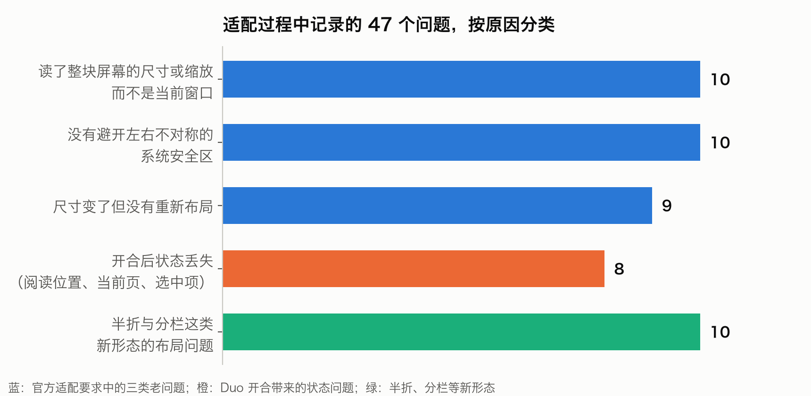
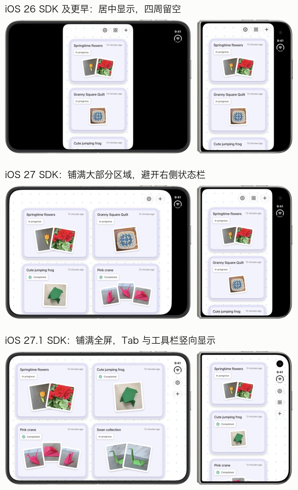
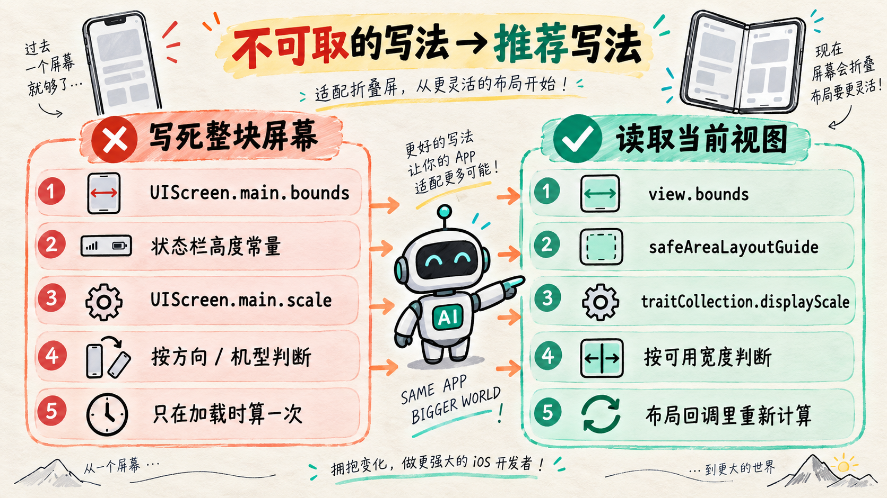
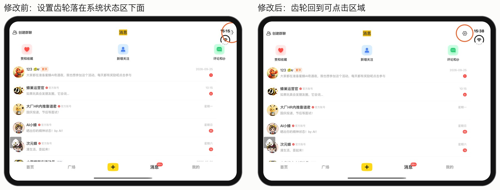
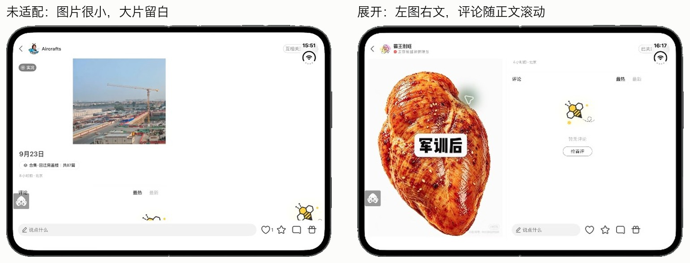
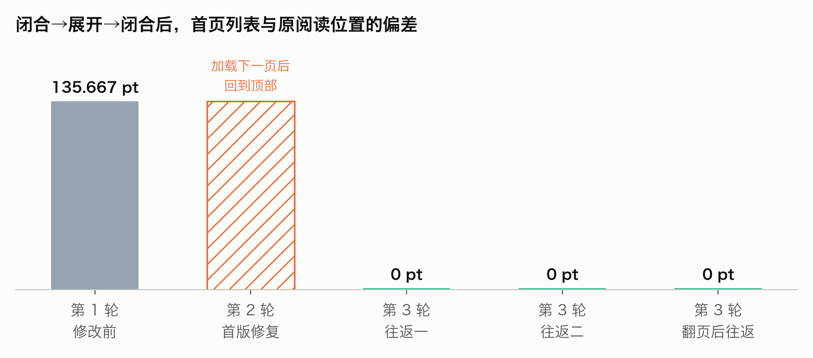

> 本文整理自 2026 年 10 月的适配实践。小蜜蜂的界面与适配效果保留原样；代码示例经过简化和脱敏，省略业务模型、内部组件与工程配置，展示适配思路，并非可直接粘贴运行的完整实现。概念配图由 AI 辅助生成，Apple 配图在文中注明来源。
>
> 运行验证使用 Device Hub 中的 Duo 模拟器（iOS 27.1），不等同于真机验收。多列信息流、侧边 Tab 和消息／详情分栏属于探索方案，不代表线上版本已经采用。


上图是适配后的小蜜蜂在 Duo 展开横屏下的样子（探索线，Device Hub 中的 Duo 模拟器）：信息流按宽度排成四列，Tab 竖排在右侧系统边缘带，搜索和内容都避开了右上角的系统状态区。

## 先说结论

iPhone Duo 是苹果今年推出的第一款折叠屏 iPhone，有闭合、展开、半折三种姿态，App 的窗口尺寸会在使用过程中变化。本文记录小蜜蜂 iOS 适配 Duo 的主要过程：先讲为什么要适配、苹果要求什么，再讲哪些旧写法要改、新 API 怎么用、每个页面怎么适配，最后讲这次适配是怎么借助 AI 推进和验证的。



四条结论：

1. **Duo 值得适配，不适配体验会明显变差。** 展开屏幕给图文浏览带来了更大的空间。没有做可变尺寸适配的小蜜蜂装到 Duo 上，首页两列卡片被拉得很宽，笔记详情的图片缩在一角，搜索和设置按钮被系统状态区压住。
2. **适配工作量很大，AI 让它能连续推进。** 改动覆盖数百个文件，集中替换屏幕尺寸常量、全局状态栏高度，并补齐安全区约束。过程中记录了 47 个问题，按原因分为五类（见上图）。盘点、分批修改、构建、安装、开合验证都由 AI 连续完成，人只在需要取舍的地方介入。
3. **闭环让适配结果更准确。** 每改一批，AI 都会把包装到 Device Hub 的 Duo 模拟器上，切换姿态、截图、判定，再改下一批。探索线累计构建 66 轮，基础线 16 轮。开合后阅读位置偏移 135.667pt 的问题经过三轮收口，最终误差为 0pt，中间失败的一轮也如实记录。
4. **适配分成两层：基础适配和新形态。** 基础适配的目标是让页面在尺寸变化时不错位、不遮挡、不丢状态。新形态包括四列信息流、侧边 Tab、消息分栏和笔记详情分栏。新形态只放在探索线上，基础线只保留基础修复，新形态可以整体撤销而不影响基础修复。

本次使用的 coding agent 是 Codex。其他具备构建、安装、界面操作和截图分析能力的 coding agent，也可以参考这套流程。

---

## 一、为什么要适配 iPhone Duo

### 1.1 Duo 是什么

iPhone Duo 是苹果的折叠屏 iPhone，包含闭合、展开、半折等使用姿态。适配的直接价值，是让 App 利用更大的可用空间，同时保持开合过程中的操作与内容连续。相关设计原则可参考 [Apple 的设计视频](https://developer.apple.com/videos/play/tech-talks/111466/)。

对小蜜蜂这样以图文信息流为主的 App 来说，展开后的大屏正适合浏览。

### 1.2 用什么 SDK 构建，Duo 上的表现就不同

苹果官方的 [Duo 准备文章](https://developer.apple.com/iphone-duo/prepare/) 说明了不同 SDK 构建出的 App 在 Duo 上的样子：



*图片来源：Apple，[Three steps to make your app shine on iPhone Duo](https://developer.apple.com/iphone-duo/prepare/)。每组左边是展开，右边是闭合。*

- **iOS 26 SDK 及更早**：能运行，但展开时 App 显示在屏幕中央，四周留空。
- **iOS 27 SDK**：App 会铺满内屏的大部分区域，但会避开右侧的状态栏。
- **iOS 27.1 SDK 及以后**：App 铺满整个屏幕，工具栏和 Tab 栏竖向显示在状态栏下方。

也就是说，只要用新 SDK 构建，App 的窗口就会随着开合变大变小。代码里如果有"屏幕就这么大"的假设，在 Duo 上就会出问题。

### 1.3 不适配的小蜜蜂长什么样


上图是用 Xcode 27 构建、但还没做可变尺寸适配的小蜜蜂，在 Duo 模拟器上展开后的样子：

- **首页**：写死 2 列，每张卡片被拉得很宽，一屏能看到的内容很少。
- **笔记详情**：图片按窄屏尺寸显示，缩在页面一角，大片留白。
- **消息**：每一行都拉满整个宽屏，阅读起来很吃力。

另外，搜索、设置按钮会被系统状态区压住（见 3.2），开合后阅读位置也会跳动（见 6.3）。这些都是用户一打开就能感觉到的问题。

---

## 二、Duo 对 App 提出了什么要求


### 2.1 四个变化与设计原则

- **窗口尺寸不再等于屏幕尺寸，而且会变。** 展开横向时，用调试器读到的窗口是 951×669pt。代码如果读的是整块屏幕的宽度、缩放比例或方向，开合后布局就会错。
- **系统安全区左右不对称。** 横向展开时，系统状态区在右侧，右侧安全区有 84pt，左侧是 0。安全区指系统栏、圆角等不能放可交互内容的区域。以前只需要处理上下，现在左右也要分别处理。
- **尺寸变化和方向变化是两回事。** 姿态变了，方向不一定变；同一个方向下，宽度也可能从 2 列变成 4 列。
- **开合时状态要保持。** 阅读位置、当前频道、正在看的图片页码、输入框里的草稿，都不能因为开合而丢失。


上图是适配后的基础版本在 Device Hub 里的三种姿态。Device Hub 是 Xcode 27.1 中用来模拟设备的窗口，可以直接切换 Duo 的姿态。本文所有运行验证都在其中的 Duo 模拟器（iOS 27.1）上完成。

苹果的设计视频 [Design for iPhone Duo](https://developer.apple.com/videos/play/tech-talks/111466/) 把这些变化归结为一句话：界面随可用空间和折叠区域调整，操作、内容和状态保持连续。落到设计上有三点：

- **按空间分两档设计，不按角度设计。** 只需要定义窄空间和宽空间下的内容关系：窄时紧凑，宽时可以同时展示列表和详情等更多层级，不必为每个折叠角度单独做一套页面。
- **关键操作始终可达。** 开合时按钮不应突然消失或大幅换位置。
- **能交给系统的先交给系统。** 系统导航容器、Sheet 等会自动适配姿态，比如系统 Sheet 在半折时会自动避开中间区域；自定义的导航栏、弹层和控件才需要单独处理。

### 2.2 苹果给出的三步

官方准备文章把适配分成三步：

1. **运行 app resizability skill。** 在 Xcode 里对编码助手说"get my app ready for iPhone Duo"，它会扫描项目、逐个解释问题并给出修改建议。用其他 coding agent 时，可以在终端执行 `xcrun agent skills export` 把这个 Skill 导出来。苹果也说明了：Skill 能找到大部分问题，但不是全部。
2. **修改常见的问题写法。** 包括不要从主屏幕取尺寸、不要用方向和机型做布局判断、检查铺满显示的图片和视频等，第三节会逐条展开。
3. **测试尺寸变化。** 推荐三种方式：Device Hub 里的可变尺寸模拟器、macOS 27 上的 iPhone 镜像（把窗口拉到极端尺寸）、Xcode 27.1 的 Duo 模拟器。苹果认为 Duo 模拟器最能还原真实体验。

### 2.3 官方视频与设计指南

除了准备文章，苹果还发布了一组 Duo 专题视频和设计指南。总入口是 [Get ready for iPhone Duo](https://developer.apple.com/iphone-duo/)，设计规范见人机交互指南 [Designing for iPhone Duo](https://developer.apple.com/design/human-interface-guidelines/designing-for-iphone-duo)。六个视频各讲一个方面：

| 视频 | 讲什么 | 和本文的关系 |
|---|---|---|
| [Design for iPhone Duo](https://developer.apple.com/videos/play/tech-talks/111466/) | 设计原则：窄和宽两档空间、操作放在哪里、内外屏差异、Sheet 与折痕避让 | 2.1 的总原则 |
| [Prepare your app for iPhone Duo](https://developer.apple.com/videos/play/tech-talks/111461/) | 基础适配：SDK 差异、动态尺寸、size class、左右安全区、系统导航容器 | 第三节的写法 |
| [Raise the bar with iPhone Duo](https://developer.apple.com/videos/play/tech-talks/111462/) | 竖向的导航栏、工具栏和 Tab 栏，按钮排列顺序，空间不足时的溢出菜单 | 5.2 Tab 栏 |
| [Strike a pose with adaptive layouts on iPhone Duo](https://developer.apple.com/videos/play/tech-talks/111463/) | 保留区域（Reserved Regions）、折叠避让、双区和叠加布局 | 第四节、5.3～5.5 |
| [Leverage multiple displays and scenes on iPhone Duo](https://developer.apple.com/videos/play/tech-talks/111464/) | 分屏、多窗口（多 Scene）、铰链交互、在另一块屏幕显示辅助内容 | 铰链 API 见第四节 |
| [Build a great camera experience for iPhone Duo](https://developer.apple.com/videos/play/tech-talks/111465/) | 开合时前置摄像头在内外屏之间切换、方向协调、预览比例 | 有拍摄功能的 App 需要单独看 |

建议的观看顺序：设计指南 → 基础适配 → Bar → 折叠布局；多窗口和相机按业务需要再看。Bar 专题视频里几个可以直接跳转的位置：2:00 接入竖向栏和系统导航容器，3:09 导航栏、工具栏和 Tab 共用侧边空间，4:29 返回、关闭、完成等按钮的排列，11:40 溢出菜单，13:10 关键操作的显示优先级。

### 2.4 官方 Skill 是什么

Skill 是一份写给 coding agent 的操作手册，告诉它遇到某类任务时按什么步骤、什么原则去做。Xcode 27.1 RC 内置了一组这样的 Skill，导出后共 10 个，和 Duo 适配直接相关的是两个：

- **app-resizability**：负责代码改造。它把工作分成五类任务，每类有单独的参考文档：替换主屏幕（`UIScreen.main`）、去掉按方向布局（`interfaceOrientation`）、去掉按机型布局（`userInterfaceIdiom`）、处理不对称安全区、从应用生命周期迁移到场景生命周期。开始改代码前，它会先检查三项工程配置：是否声明了启动屏、iPad 方向是否完整、是否设置了 `UIRequiresFullScreen`。
- **device-interaction**：负责在设备或模拟器上验证，包括截图、读取界面层级、模拟点击。

app-resizability 里有几条原则，对这次适配影响很大：

- **离使用处最近**：取尺寸、缩放比例时，优先用当前视图的信息，而不是窗口或屏幕的。
- **不能用全局对象代替**：不能把 `UIScreen.main` 换成 `UIApplication.shared` 或 `UIDevice.current`。附近没有视图可用时，就给方法加参数，让调用方传进来。
- **修改要成组完成**：替换取值的同时，必须加上变化时的响应，比如监听缩放比例变化。只改一半不算完成。
- **不顺手清理**：只改目标写法所在的行，不动周边格式和其他问题。
- **不能留下空改动**：文件里有目标写法，就必须给出修改或明确的跳过理由，不能悄悄略过。

这次适配以这个 Skill 为基础，再补充项目盘点和验证（见第六节）。device-interaction 依赖的设备工具接口在这次 RC 中没能连通，验证改为直接操作 Device Hub 窗口并截图。

---

## 三、不可取的写法与推荐写法



下面逐类说明，代码示例由这次适配的修改整理而来，已去除内部命名和业务依赖。

### 3.1 不要用整块屏幕的尺寸，用当前视图的尺寸

存储空间页的占比条，原来按屏幕宽度计算条的长度：

```swift
// 修改前：按屏幕宽度算，开合后长度不变
let totalWidth = UIScreen.main.bounds.width - Layout.horizontalPadding * 2
var phoneWidth = CGFloat(phoneTotalRatio) * totalWidth
```

改成相对父视图的比例约束，宽度变了，条的长度自动跟着变：

```swift
// 修改后：按父视图宽度的比例布局
make.width.equalToSuperview().multipliedBy(phoneTotalRatio).priority(999)
make.width.greaterThanOrEqualTo(minVisibleWidth)
```

列表"滚动到多远开始加载更多"的阈值，原来是屏幕高度的两倍，现在改为当前列表高度的两倍：

```swift
let threshold = scrollView.bounds.height * 2   // 原来是 UIScreen.main.bounds.height * 2
```

### 3.2 不要用状态栏高度常量，用安全区

消息页顶部原来从状态栏高度往下排，右上角的设置按钮按整个顶部视图的右边缘放置，结果在 Duo 上落进了右侧的系统状态区：

```swift
// 修改前
make.top.equalToSuperview().offset(cachedStatusBarHeight)
// 修改后：顶部和左右都跟随所属视图的安全区
make.top.equalTo(listContentView.safeAreaLayoutGuide.snp.top)
make.right.equalTo(topContentView.safeAreaLayoutGuide.snp.right).offset(-12)
```



首页的搜索按钮也是同样的原因。下图展示修复后的页面，搜索按钮位于右侧系统状态区之外：


### 3.3 缩放比例从当前视图读取，并响应变化

细分割线、图片缓存常常按屏幕缩放比例计算。Duo 的内外屏切换时，缩放比例可能变化，所以要从视图的 `traitCollection` 读取，并在变化时刷新：

```swift
private func observeDisplayScaleChanges() {
    if #available(iOS 17.0, *) {
        registerForTraitChanges([UITraitDisplayScale.self]) { (view: AdaptiveImageGridView, _: UITraitCollection) in
            view.refreshImagesForDisplayScale()
        }
    }
}

// iOS 17 以下的兜底
override func traitCollectionDidChange(_ previousTraitCollection: UITraitCollection?) {
    super.traitCollectionDidChange(previousTraitCollection)
    if #available(iOS 17.0, *) { return }
    guard let previous = previousTraitCollection,
          previous.displayScale != traitCollection.displayScale else { return }
    refreshImagesForDisplayScale()
}
```

这里体现了"修改要成组完成"：把 `UIScreen.main.scale` 换成 `traitCollection.displayScale` 的同时，必须加上变化监听，否则只在初始化时读对一次。

### 3.4 不要按方向或机型判断布局，按可用空间判断

以消息页是否分成左右两栏为例（见 5.3），不看设备是不是"横屏"或"iPad"，只看当前安全区内的可用宽高：

```swift
private var shouldUseConversationColumns: Bool {
    guard let host = view else { return false }
    let size = host.safeAreaLayoutGuide.layoutFrame.size
    return size.width >= 760 && size.width > size.height
}
```

### 3.5 不要只在加载时算一次，在布局回调里重新算

依赖尺寸的计算放在 `viewDidLayoutSubviews` / `layoutSubviews` 里，并且只在尺寸真正变化时才重新排版，避免每次布局都做重活。公共瀑布流组件的做法是记住上一次的宽度、字号和缩放比例，任何一项变了才更新列数并重新测高：

```objc
BOOL metricsChanged = self.lastViewWidth != currentWidth
    || layout.columnCount != columns
    || categoryChanged                       // 系统字号变了
    || self.lastDisplayScale != displayScale // 缩放比例变了
    || !CGRectEqualToRect(self.lastCollectionFrame, collectionFrame);
if (currentWidth > 0 && metricsChanged) {
    layout.columnCount = MAX(1, columns);
    [self.presenter viewWillTransitionToSize:collectionView.bounds.size]; // 按新卡宽重新测高
}
```

### 3.6 官方点名的其他写法

准备文章还列出了几条容易漏掉的写法，自查和写新页面时都要注意：

- **创建窗口用场景**：`UIWindow(frame: UIScreen.main.bounds)` 改为 `UIWindow(windowScene:)`。
- **不要保存 `UIScreen` 对象**：需要屏幕信息时，用 `view.window?.windowScene?.screen` 现取。
- **不要比较具体机型尺寸**：类似 `bounds.height == 844` 的判断，或一份已知 iPhone 尺寸列表，在 Duo 上都对不上。
- **宽度为 regular 不等于 iPad**：Duo 内屏上 iPhone App 也会出现 regular 宽度，原来只给 iPad 的布局会在 iPhone 上生效。
- **检查铺满显示的图片和视频**：设成 `.scaleAspectFill` 的头图和视频在更宽的屏幕上可能裁掉关键内容，要按当前比例选择 fill 或 fit，或者设置焦点。

### 3.7 命中不等于缺陷

扫描出来的 `UIScreen.main`、状态栏高度，并不都需要改，要按用途判断：

- 图片高分辨率预取读的是屏幕尺寸，但它是请求参数，不是布局，不能机械地改成窗口尺寸。
- 某个列表表头用屏幕宽度初始化，但 `UITableView` 本身会接管表头宽度，这只算接口清理。
- 第三方库里的命中不改。

---

## 四、Duo 相关的新 API

除了上面这些"改旧写法"，这次适配还用到了以下几个较新的 API，其中三个是 iOS 27.1 为折叠屏新增的：

| API | 作用 | 本次用在哪里 |
|---|---|---|
| `UIWindowScene.effectiveGeometry`、`windowScene(_:didUpdateEffectiveGeometry:)`（iOS 26） | 场景窗口几何变化的回调，可以知道是否正在交互式调整大小 | 启动和窗口变化时，同步全局的窗口尺寸缓存 |
| `traitCollection.verticalBarEdge`（iOS 27.1） | 系统建议把竖向栏放在哪一侧：前侧（Leading）、后侧（Trailing），或未指定（Unspecified，此时栏留在底部） | 自绘 Tab 决定显示在底部、左侧还是右侧 |
| `UIViewReservedRegion`、`reservedRegionsOfKind:`（iOS 27.1） | 查询视图内被保留的区域，`divisionRegionKind` 表示折痕分隔区，`occlusionRegionKind` 表示遮挡区，区域已包含交互边距 | 侧栏里的按钮避开折痕和遮挡区 |
| `UIHingeInteraction`（iOS 27.1） | 铰链状态变化时回调 | 开合时触发 Tab 重新布局 |
| `registerForTraitChanges`、`UITraitDisplayScale`（iOS 17） | 监听指定 trait 的变化 | 缩放比例变化时刷新缓存的细线和图片 |

场景几何回调的用法：

```swift
@available(iOS 26, *)
func windowScene(_ windowScene: UIWindowScene,
                 didUpdateEffectiveGeometry previousEffectiveGeometry: UIWindowScene.Geometry) {
    let geometry = windowScene.effectiveGeometry
    updateAppGeometry(for: windowScene, interactivelyResizing: geometry.isInteractivelyResizing)
}
```

Tab 控制器同时监听竖向栏位置的变化和铰链变化，任何一个变了都重新布局：

```objc
if (@available(iOS 27.1, *)) {
    NSMutableArray *traits = [[UITraitCollection systemTraitsAffectingVerticalBarEdge] mutableCopy];
    [traits addObject:[UITraitLayoutDirection class]];
    [self registerForTraitChanges:traits withHandler:^(id<UITraitEnvironment> env, UITraitCollection *previous) {
        [weakSelf.view setNeedsLayout];
    }];
    UIHingeInteraction *interaction = [[UIHingeInteraction alloc] initWithUpdateHandler:^(UIHingeInteraction *i, UIHingeInteractionUpdate *u) {
        [weakSelf.view setNeedsLayout];
    }];
    [self.view addInteraction:interaction];
}
```

侧栏里的按钮先收集所有生效的保留区域，再在剩余空间里找最长的一段来放：

```objc
for (UIViewReservedRegionKind *kind in @[[UIViewReservedRegionKind divisionRegionKind],
                                          [UIViewReservedRegionKind occlusionRegionKind]]) {
    for (UIViewReservedRegion *region in [self reservedRegionsOfKind:kind]) {
        CGRect frame = CGRectIntersection(contentFrame, region.frame);
        if (region.active && !CGRectIsNull(frame) && !CGRectIsEmpty(frame)) {
            [blockedFrames addObject:[NSValue valueWithCGRect:frame]];
        }
    }
}
// 之后按位置排序，取被挡区域之间最长的一段作为按钮的排布范围；栏的背景本身保持连续
```

保留区域也可以用来让列表避开折痕。这次一开始在瀑布流里也接入了折痕避让，后来发现对连续滚动的列表效果不好（见 5.5），按 [Strike a pose with adaptive layouts on iPhone Duo](https://developer.apple.com/videos/play/tech-talks/111463/) 中"连续滚动的内容不需要整体移位"的建议撤掉了，只在侧栏按钮这类固定控件上保留。

官方视频里还介绍了几个这次没有用到、但新页面值得优先考虑的 API：

- **`visibilityPriority`、`axisBehavior`、`additionalOverflowItems`**：给栏上的按钮设置显示优先级、竖排时的表现，以及空间不足时放进溢出菜单的项。高频操作和角标设高优先级，空间不够时其余按钮自动收进溢出菜单。
- **`UIArrangementViewController`**：系统提供的双区内容容器，支持并排、上下或叠加三种关系。官方建议导航容器放在它的外面。
- **`AVCaptureDeviceDirectionCoordinator`**：需要单独控制内外屏前置摄像头时，用它响应方向变化；普通拍摄直接用系统的虚拟前置摄像头即可，由系统自动切换。

这些 API 的版本要求和最终签名以对应的 SDK 为准。

---

## 五、各页面怎么适配

适配分两层。**基础适配**是所有页面都要做的：按当前尺寸布局、避开安全区、尺寸变化后重新排版、开合后保持状态，第三节的写法都属于这一层。**新形态**是在大屏上重新设计的布局，下面 5.1～5.4 都属于这一层。

推进时按三个阶段排优先级：

| 阶段 | 优先级 | 内容 | 完成标准 |
|---|---|---|---|
| 基础可用 | P0 | 已有窗口适配的回归、键盘和弹层、安全区、开合状态保持 | 内容不被遮挡，操作可达，草稿、播放等状态连续 |
| 平台交互 | P0/P1 | 评估兼容模式和公共导航容器；侧边栏、溢出菜单、折叠避让 | 关键操作在各种形态下都能找到、能用 |
| 体验增强 | P2 | 多列信息流、消息分栏、详情与评论并排、媒体双区 | 经设计确认，确实提升使用效率 |

检查时先看公共容器（瀑布流、分页、自绘 Tab 栏和导航栏、弹层），再看页面：首页导航、详情互动、发布确认，以及评论、分享、视频控制、图片编辑这类自定义面板。

下面的代码展示探索方案的布局关系，已简化内部组件与业务判断。尺寸阈值是本次页面的取舍，不是 Duo 的通用标准；其他页面应结合 size class、内容可读宽度和动态字号确定布局。

### 5.1 首页信息流：按可用宽度决定列数


原来首页写死 2 列，展开后卡片被拉得很宽。现在由业务层根据可用宽度算出列数，交给公共瀑布流组件：

```swift
public enum AdaptiveGridMetrics {
    public static func layout(for view: UIView?, columnSpacing: CGFloat = 5) -> (insets: UIEdgeInsets, columns: Int, cellWidth: CGFloat) {
        guard let view = view, view.bounds.width.isFinite, view.bounds.width > 0 else {
            return (UIEdgeInsets(top: 5, left: 5, bottom: 5, right: 5), 1, 0)
        }
        let safeInsets = view.safeAreaInsets
        // 160pt 是卡片的阅读宽度，随系统字号放大
        let minimumCardWidth = max(160, UIFontMetrics.default.scaledValue(for: 160, compatibleWith: view.traitCollection))
        let insets = UIEdgeInsets(top: 5, left: safeInsets.left + 5, bottom: 5, right: safeInsets.right + 5)
        let availableWidth = max(0, view.bounds.width - insets.left - insets.right)
        let spacing = max(0, columnSpacing)
        var columns = max(1, Int(floor((availableWidth + spacing) / (minimumCardWidth + spacing))))
        // 超过两列时优先用偶数列，不设上限
        if columns > 2 && columns % 2 != 0 { columns -= 1 }
        let width = max(0, (availableWidth - CGFloat(columns - 1) * spacing) / CGFloat(columns))
        return (insets, columns, width)
    }
}

// 各列表的 presenter 不再返回固定的 2
func waterFlowColumnCount() -> Int {
    AdaptiveGridMetrics.layout(for: layoutView, columnSpacing: waterFlowColumnSpace()).columns
}
```

列数变化会让卡片换位置，原来正在看的那张卡片可能跑到屏幕外。公共瀑布流组件在每次稳定布局后记下"正在看的卡片"和它到视口顶部的距离，尺寸变化引起的重排之后按这张卡片恢复滚动位置：

```objc
// 记录：取视口内最靠上的一张卡片，以及它到视口顶部的距离
self.readingAnchorModel = self.modelList[path.item];
self.readingAnchorDistance = y - visibleTop;

// 恢复：重新排版后，把同一张卡片放回同样的距离；用户正在拖动或刷新时不恢复
NSUInteger index = [self.modelList indexOfObjectIdenticalTo:anchorModel];
UICollectionViewLayoutAttributes *attributes = [collectionView layoutAttributesForItemAtIndexPath:
                                                [NSIndexPath indexPathForItem:index inSection:0]];
CGFloat targetY = CGRectGetMinY(attributes.frame) - visibleDistance - updatedInsets.top - topMask;
[collectionView setContentOffset:CGPointMake(collectionView.contentOffset.x,
                                             MIN(maximumY, MAX(minimumY, targetY))) animated:NO];

// 数据更新时，只有这张卡片已经不在列表里才清掉记录（第 2 轮失败的修正，见 6.3）
if (self.readingAnchorModel && [listData indexOfObjectIdenticalTo:self.readingAnchorModel] == NSNotFound) {
    self.readingAnchorModel = nil;
}
```

几个要点：

- 左右边距加上安全区，卡片不会进入系统状态区。
- 最小卡宽跟随系统字号。大字号下，同样的宽度会少排几列，保证文字可读。
- 列数变化后，卡片高度要按新卡宽重新测量（3.5 中的 `viewWillTransitionToSize:`）。

### 5.2 Tab 栏：闭合时竖排到侧边


按 Bar 专题视频的说法，由 `UINavigationController`、`UITabBarController` 管理的栏会自动参与竖向布局；单独创建的 `UIToolbar`、`UINavigationBar`、`UITabBar`，以及自绘的栏，都不会自动竖排。小蜜蜂用的是自绘 Tab 栏，所以要自己处理：由 `verticalBarEdge` 决定 Tab 放在底部、左侧还是右侧。竖排的位置也不能写死在右侧，分屏时操作区要沿着各自 App 的外侧排布。

```objc
- (void)updateTabBarLayout {
    CGRect bounds = self.view.bounds;
    CGRect safeFrame = self.view.safeAreaLayoutGuide.layoutFrame;
    NSInteger edge = 0; // 0 底部，1 左侧，2 右侧（物理方向）
    if (@available(iOS 27.1, *)) {
        UIVerticalBarEdge preferredEdge = self.view.traitCollection.verticalBarEdge;
        BOOL rightToLeft = self.view.effectiveUserInterfaceLayoutDirection == UIUserInterfaceLayoutDirectionRightToLeft;
        if (preferredEdge == UIVerticalBarEdgeLeading) {
            edge = rightToLeft ? 2 : 1;
        } else if (preferredEdge == UIVerticalBarEdgeTrailing) {
            edge = rightToLeft ? 1 : 2;
        }
    }
    CGRect barFrame;
    if (edge == 0) {
        CGFloat height = MIN(self.tabBarHeight, CGRectGetHeight(safeFrame));
        barFrame = CGRectMake(CGRectGetMinX(bounds), CGRectGetMaxY(safeFrame) - height, CGRectGetWidth(bounds), height);
    } else {
        // 竖向时直接使用系统已经留出的边缘带，不在安全区内再占一次宽度
        CGFloat x = edge == 1 ? CGRectGetMinX(bounds) : CGRectGetMaxX(safeFrame);
        CGFloat width = edge == 1 ? CGRectGetMinX(safeFrame) - CGRectGetMinX(bounds)
                                  : CGRectGetMaxX(bounds) - CGRectGetMaxX(safeFrame);
        barFrame = CGRectMake(x, CGRectGetMinY(safeFrame), MAX(0, width), CGRectGetHeight(safeFrame));
    }
    // ……设置 tabBar.frame，内容区让出 barFrame
}
```

排列顺序上，官方建议返回、关闭放在最前，接着是"完成"这类主要操作，并保留原有的分组；输入框这种需要宽度的区域不要简单旋转成竖条。

这里有过一次返工：第一版把侧栏放在安全区内部，等于在系统边缘带之外又占了一次宽度，正文被挤窄。修正后就是上面 `else` 分支的写法：侧栏直接使用系统留出的边缘带，按钮紧凑成组，正文恢复原来的列数。侧栏内的按钮再通过保留区域避开折痕和遮挡区，竖向栏位置和铰链变化时触发重新布局（代码见第四节）。

### 5.3 消息 Tab：左列表、右会话


展开横屏时，消息页变为左右两栏：左侧是消息列表和"赞和收藏""新增关注""评论和@"三个入口，右侧是选中的会话。会话页放在一个内嵌的导航控制器里，开合时只改 frame：

```swift
override func viewDidLayoutSubviews() {
    super.viewDidLayoutSubviews()
    let bounds = view.bounds
    usesConversationColumns = shouldUseConversationColumns          // 判断条件见 3.4
    let listWidth = usesConversationColumns ? min(340, bounds.width * 0.38) : bounds.width
    let dividerWidth = 1 / max(traitCollection.displayScale, 1)     // 一像素分隔线
    let conversationX = listWidth + dividerWidth
    listContentView.frame = CGRect(x: 0, y: 0, width: listWidth, height: bounds.height)
    conversationDivider.isHidden = !usesConversationColumns
    conversationNavigationController.view.frame = usesConversationColumns
        ? CGRect(x: conversationX, y: 0, width: max(0, bounds.width - conversationX), height: bounds.height)
        : bounds
    // 窄屏时：选中了会话就全屏显示会话，否则显示列表
    conversationNavigationController.view.isHidden = !usesConversationColumns && selectedConversationKey == nil
    listContentView.isHidden = !usesConversationColumns && selectedConversationKey != nil
}

// 窄屏且已选择会话时隐藏 Tab；具体接入由应用的导航容器负责。
```

规则如下：

- **何时分栏**：安全区内宽度 ≥ 760pt，且宽大于高。
- **左栏宽度**：`min(340pt, 38%)`。半折时沿用展开时的比例。
- **初始状态**：没有选择会话时，右侧显示"选择一个会话"，不自动打开任何会话。
- **闭合时**：保留当前的聊天页实例，聊天全屏显示，可以返回列表；再展开时恢复左右两栏。尺寸变化只重新布局，不重建聊天页、不重新拉数据。
- **选中状态**：用"会话类型:会话 ID"作为 key 记录，不用列表的行号；切换账号时清空。
- **三个入口**：仍然打开原来的完整页面，返回后保留选中的会话和列表位置。

### 5.4 笔记详情：左图右文



展开横屏时，图文和图集笔记变为左右两栏：左侧是图片，右侧是正文和评论，两侧分别滚动。实现方式是把原来的图片组件挂到左侧容器里，正文容器整体移到右侧：

```objc
// 简化示意：业务层只传入“当前内容是否适合分栏”。
CGRect safeFrame = self.view.safeAreaLayoutGuide.layoutFrame;
BOOL columns = contentSupportsColumns
    && CGRectGetWidth(safeFrame) >= minimumSplitWidth
    && CGRectGetWidth(safeFrame) > CGRectGetHeight(safeFrame);

if (columns) {
    CGFloat bodyWidth = MIN(CGRectGetWidth(safeFrame) * 0.5, maximumReadingWidth);
    CGFloat bodyX = CGRectGetMaxX(safeFrame) - bodyWidth;
    CGFloat dividerWidth = 1 / MAX(self.view.traitCollection.displayScale, 1);
    CGRect mediaFrame = CGRectMake(CGRectGetMinX(safeFrame), contentTop,
        MAX(0, bodyX - dividerWidth - CGRectGetMinX(safeFrame)), contentHeight);
    CGRect bodyFrame = CGRectMake(bodyX, contentTop, bodyWidth, contentHeight);
    // 将原图片组件移到左栏，正文与评论布局到右栏。
    // 保留组件实例和页码；退出分栏时移回原容器。
}
```

规则如下：

- **何时分栏**：有图片或小游戏、安全区宽度达到本次设定的 760pt，且宽大于高时考虑分栏；视频和音乐图集保持原来的样式。
- **右栏宽度**：取一半宽度，但不超过原有的 700pt 阅读宽度上限。
- **复用原组件**：图片仍然是原来的图集组件，页码由它自己管理；闭合后图片回到原来的纵向布局里。
- **只在变化时重排**：记录上一次的安全区和是否分栏，两者都没变就直接返回，避免每次布局都重挂图片。
- **预加载替换**：正式数据替换预加载的视图时，先解除旧图片的挂载，否则会出现两份图片、正文高度算错（这是验证中真实发现的问题）。

### 5.5 半折：连续排布

半折时，屏幕中间有一条折痕。最初的方案是用第四节的保留区域查询折痕位置，让信息流卡片左右分区、避开折痕；运行后发现竖向半折时，列表被截成了上半屏，下半屏空白。折叠布局视频也建议，连续滚动的信息流不应因为折叠而频繁整体跳动，保留区域更适合用在固定控件上。最终决定横竖半折都按连续内容排布，不做中央避让，所以瀑布流里的折痕分区代码已经删除；消息和详情的分栏直接沿用展开时的比例，不需要额外代码。这个过程见 6.6。

---

## 六、AI 怎么推进：先盘点，再跑闭环

### 6.1 先盘点

第一轮修改之前，AI 先导出官方 Skill，读官方准备文章，然后对全 App 做盘点：

- 将屏幕尺寸、设备方向等候选写法合并去重，逐个文件说明处理理由，检查遗漏与重复。
- 将安全区、场景生命周期相关的候选单独追踪，区分已复现问题、潜在布局风险与接口清理。

盘点结果决定了分批顺序：先修已经在旧包上复现的问题，再修可能影响布局的候选，最后处理只需要清理接口的部分。

### 6.2 再跑闭环


每一轮按六步走：

1. **适配修改。** 一次只改一批文件，通常几个到十几个。每批开始前记录这批文件的指纹，结束后核对没有改到批次之外的文件。
2. **构建与签名。** 完整编译；检查 App 的嵌入产物签名，并做严格校验。
3. **安装启动。** 安装到 Device Hub 中指定的 Duo 模拟器。设备用唯一编号确认，不按名称；同时核对运行时确实是 iOS 27.1。安装后再比对一次：设备上的二进制必须和本轮构建产物一致，否则看到的可能是旧包。
4. **开合与截图。** 在闭合、展开、半折之间切换，加上旋转、横滑、进入二级页再返回，每个状态截图。
5. **判定。** AI 逐张查看截图，必要时用调试器只读读取窗口尺寸、安全区和列表位置。结果分为通过、局部通过、未通过、待验四种。
6. **写回记录。** 每个问题写入缺陷记录，包括复现路径、根因、修复方式、不能被破坏的既有行为、验证结果和证据位置，然后决定下一批改什么。

消息页的齿轮问题就是在闭环里发现的：上一轮验证"赞和收藏"二级页时，返回消息主页的截图里，齿轮落在了系统状态区下面；下一轮修复；再下一轮在横向和纵向分别点击齿轮进入设置并返回，确认通过。

### 6.3 案例：阅读位置要三轮才收口



用户在首页滚动到中段，闭合、展开、再闭合，回来时应该还在原来的位置。

- **第 1 轮，先测量。** 在同一个首页实例上真实滚动后开合往返。40 张卡片的身份和顺序完全一致，卡片位置也恢复了原值，但列表滚动位置从 2529.333pt 变成了 2393.667pt，偏了 135.667pt。原因是每次重新布局都会重新挑一张"当前可见的卡片"作为锚点，列数变化后露出来的是另一张卡片，锚点就换了。
- **第 2 轮，首版修复。** 在公共瀑布流组件里记录一个阅读快照：用户正在看的那张卡片，以及它和视口顶部的距离。尺寸变化引起重新布局时复用这个快照，不重新选锚点。一次展开的误差是 0.000244pt；但再闭合时列表加载了下一页，数据回调无条件清空了快照，列表回到顶部。这一轮记为失败，没有当作通过。
- **第 3 轮，修正。** 只有当原来那张卡片已经不在数据里时才清空快照。三组往返实测：491→172.667→491pt，877→573.667→877pt，以及加载下一页之后的 2748.667→1327.667→2748.667pt，误差都是 0。

状态类问题的判定要靠数据。第二轮如果只看一次展开的截图，就会被当成通过。

### 6.4 让闭环本身转起来

闭环跑起来之前，构建和安装环节也有不少问题，都是在环里由 AI 处理的：

- **链接失败。** 前四轮构建都在链接阶段失败：部分第三方依赖没有模拟器可用的架构切片。AI 在一个独立的验证工作区里处理模拟器兼容，产品仓库不改任何第三方二进制。第五轮构建成功。
- **启动即退出。** 新包安装后一启动就退出。崩溃报告显示系统拒绝加载一个改过但没有重新签名的框架。AI 检查并修复验证产物的模拟器签名，严格校验后启动正常。
- **截到黑屏。** Duo 开合时会在两块显示屏之间切换，默认截图可能截到未激活的那一块，得到一张全黑的图。黑屏截图只用于诊断，不计入验收；每张截图都要核对是哪块显示屏。
- **模拟器卡住。** 开合后偶尔会短暂黑屏或无响应。处理方式是等待恢复，不重启模拟器、不开第二个 Device Hub 实例、不清除 App 数据。

### 6.5 判定口径

闭环能不能起作用，取决于"通过"的标准是否严格：

- **静态检查和编译通过，只说明通过了相应检查。** 不能替代在设备上开合运行。
- **截图要逐张查看，并核对来源。** 黑屏截图不算；旧包的截图不能证明新包；某一轮的证据不能套用到改过源码的下一轮。
- **安装包必须与本轮源码一致。** 比对设备上的二进制和构建产物，避免"改了代码，装的却是旧包"。
- **自动操作没触发，既不算通过，也不算 bug。** 比如自动横滑没能切换频道，只说明自动手势做不到，需要人手动补验，补验结果单独标注为人工验证。
- **分开记录"局部通过"和"整体通过"。** 例如评论输入框：三种姿态下分别唤起都正常，和"输入过程中开合仍能保持"是两个不同的用例。

### 6.6 人在闭环里做什么

AI 跑环，人做取舍。这次人参与的地方主要有四处：

- **交互取舍。** 半折时信息流要不要避开折痕，先按要求做了避让；运行后发现竖向半折时列表被截成上半屏，AI 参考折叠布局视频改为连续列表不整体移位；最后由人决定取消横向半折的中央避让，横竖统一连续排布。
- **自动操作做不到的补验。** 半折时左右横滑切换频道，自动手势没能触发。AI 修复后请人在同一个包上手动慢速往返，人回复"两组横滑都已稳定"，记为人工局部通过。
- **接受风险。** 小游戏详情页的"开始游戏"按钮在模拟器里自动和手动点击都没有反应，人判断可能是模拟器的问题，决定这一轮暂缓，游戏交互不计为通过。
- **拆分基础与新形态。** 第五节的四个新形态是否上线需要产品决定。所以先把安全区、分页一致性、输入栏避让这类基础修复单独提交，再保存新形态，最后形成两条分支：**探索线**保留新形态；**基础线**恢复原来的两列布局、底部 Tab 和原消息/详情页，保留全部基础修复。基础线是按提交逐个撤销新形态得到的，没有重置整条长期分支；之后又单独构建了 16 轮，修复了一个半折返回首页时相邻频道页盖住当前页的问题。

---

## 结语

Duo 适配的工作分两部分：一部分是把散落在几百个文件里的旧写法改掉，另一部分是让每一处改动都在真实的开合形态下得到确认。前者靠官方 Skill 和全量盘点，后者靠闭环。AI 把这两部分连续执行起来，让一次覆盖数百个文件的适配能够按批次稳步推进；人则把精力放在 AI 不该替人决定的问题上：这个页面在大屏和半折时应该长成什么样，以及哪些风险可以接受。
